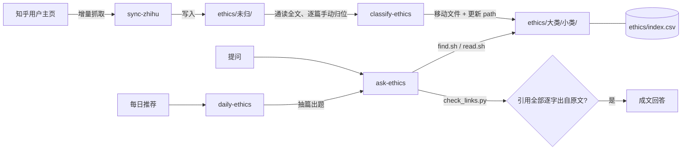

# 伦理学习库 · ethics-knowledge

一个**让 AI 助手只凭原文回答问题**的个人知识库工具箱。

它把知乎作者 john-hexa 的伦理类回答抓下来，按「素问伦理树」归档成一个本地 Markdown 库；再用一组 Claude / Cursor 技能（skills）约束助手：回答问题前必须先检索、通读原文，成文处处带可点击的出处链接，并在交稿前自动校验每条引用确实出自原文。

没有服务端，没有数据库，没有向量检索——只有目录、一张 CSV 和四个 skill。

## 特点

- **增量同步**：只抓新回答，已有的按回答 id 跳过。
- **人读式归类**：不靠关键词、不靠分类器。由助手通读每篇全文，再手动挪进伦理树的某个小类。
- **有出处的回答**：成文是一篇连贯文章，引用是正文里的 markdown 链接，指向仓库内相对路径。
- **引用自检**：`check_links.py` 检查每条链接的文件是否存在、链接文字是否逐字出自那篇文章，不通过不交稿。
- **今日一问**：每天确定性地抽一篇做种子，出一个生活问句并作答。
- **自包含**：每个 skill 的脚本、日志、缓存都在自己的目录里，拷走一个目录就是一个完整的 skill。

## 架构



整条流水线分四步，每步一个 skill，互不越界：

| skill | 做什么 | 不做什么 |
|---|---|---|
| `sync-zhihu` | 增量抓取新回答，写入 `ethics/未归/`，追加 `index.csv` | 不归类 |
| `classify-ethics` | 助手通读 `未归/` 里新抓的每篇，选一个二级小类并移动，同步 `index.csv` | 不写脚本代劳判断 |
| `ask-ethics` | 拆题 → 全库检索 → 读全文 → 用原文口吻成文 → 自检链接 | 不用库外常识补观点 |
| `daily-ethics` | 脚本抽一篇，出一句生活问句，再交给 `ask-ethics` 作答 | 不布置课程 |

### 目录结构

```
.
├── AGENTS.md                         # 仓库规则与伦理树（助手每次对话都会读到）
├── CLAUDE.md                         # 内容是 @AGENTS.md
├── ethics/
│   ├── index.csv                     # 总表：path,title,votes,created,chars,url
│   ├── <大类>/<小类>/<id>-<标题>.md   # 一篇一个文件，只出现在一个小类下
│   └── 未归/                         # 新抓取、尚未归类的文章
└── .claude/skills/                   # 四个 skill；.cursor/skills 是指向它的软链
    ├── sync-zhihu/
    │   ├── SKILL.md
    │   ├── scripts/zhihu_sync.py
    │   ├── .zhihu_cookie             # 你的登录 Cookie（已 .gitignore，切勿提交）
    │   └── .cache/                   # 运行时下载的签名脚本（已 .gitignore）
    ├── classify-ethics/
    │   └── SKILL.md
    ├── ask-ethics/
    │   ├── SKILL.md
    │   └── scripts/{find.sh, read.sh, check_links.py}
    └── daily-ethics/
        ├── SKILL.md
        ├── scripts/daily.py
        └── daily-log.csv             # 抽篇记录
```

### 文章格式

每篇是带 frontmatter 的 Markdown，正文保持抓取时的样子，不被改写：

```markdown
---
title: "工程师"
content_id: "716941677"
question_id: "327471497"
voteup_count: 20349
created: 2019-06-15
url: "https://www.zhihu.com/question/327471497/answer/716941677"
author: john-hexa
---

# 工程师

> 原文：https://www.zhihu.com/question/…
> 赞 20349 · 评论 803 · 2019-06-15

正文……
```

### 素问伦理树

目录名即分类，以目录为准。每篇只放一个二级小类。

- **与自己**：与身心 与素质 与欲望 与能力 与时间 与财产 与名誉 与原则 与信念 与理想
- **与亲族**：与父母 与兄弟姐妹 与亲戚 与配偶 与子女 与动物伙伴
- **与友人**：与恋人 与朋友 与同学 与邻人 与同志
- **与合作者**：与平台 与受教者 与共事者 与管理者 与被管理者 与服务者 与被服务者
- **与社会**：与组织 与社区 与舆论 与文化 与艺术 与历史 与技术
- **与自然**：与生灵 与环境 与科学
- **与其它**：与陌生人 与敌人 与AI 馆务
- **未归**

## 快速开始

### 环境

- 支持 skills 的 AI 助手：[Claude Code](https://claude.com/claude-code)，或 Cursor（`.cursor/skills` 软链到 `.claude/skills`）。
- 本机有 `python3`（含 `requests`）、`node`、`bash`、`grep`。

### 1. 克隆并进入仓库

```bash
git clone <this-repo> ethics-knowledge && cd ethics-knowledge
```

用 Claude Code 或 Cursor 打开这个目录，助手会自动读到 `AGENTS.md` 和四个 skill。

### 2. 同步文章（`sync-zhihu`）

仓库已自带抓取时的全部文章（`ethics/`），克隆后即可直接提问。只有想拉取作者的新回答时才需要这一步。

1. 浏览器登录知乎，复制整条 Cookie（必须含 `d_c0`）。
2. 二选一提供给脚本：
   - 环境变量 `ZHIHU_COOKIE`；
   - 写入单行文件 `.claude/skills/sync-zhihu/.zhihu_cookie`。
3. 对助手说「同步知乎」，或手动运行：

```bash
# 首次先看会抓什么，不落盘
python3 .claude/skills/sync-zhihu/scripts/zhihu_sync.py fetch --dry-run

# 正式增量抓取
python3 .claude/skills/sync-zhihu/scripts/zhihu_sync.py fetch

# 想抓别的作者：指定 url_token 和写入 frontmatter 的作者名
python3 .claude/skills/sync-zhihu/scripts/zhihu_sync.py fetch --token <url_token> --author <名字>
```

常用参数：`--full` 扫完全部分页补断档；`--limit N` 限制条数；`--interval` 分页间隔（默认 2 秒，请勿调低）。遇到 401/403 就停下，更新 Cookie 后再试。

首次运行会把 MediaCrawler 的签名脚本 `libs/zhihu.js` 下载到 `.cache/`。该脚本不随本仓库分发。

### 3. 归类（`classify-ethics`）

对助手说「归类新文章」。它会逐篇读完全文、选一个小类、移动文件并同步 `index.csv`，最后汇报每篇的去向和理由；拿不准的留在 `未归/`。

### 4. 提问（`ask-ethics`）

直接问一个伦理、组织、教育、批评、对错类的问题，比如：

> 怎样学好技术做好产品？

助手会：

1. 把问题拆成子问题，用 `scripts/find.sh` 在全库按命中数排序候选；
2. 用 `scripts/read.sh` 读完整正文，不截断；
3. 过相关性闸门，答非所问的篇目弃用；
4. 以原文口吻写成一篇连贯文章，引用做成正文里的链接；
5. 用 `scripts/check_links.py` 校验每条链接，通过才交稿。

手动用这三个脚本也行：

```bash
cd .claude/skills/ask-ethics
scripts/find.sh 学习 技术 产品                      # 候选篇目，按命中数排序（TOP=50 可调条数）
scripts/read.sh 与自己/与能力/3632149835-实际产品.md   # 读完整正文
python3 scripts/check_links.py /tmp/answer.md       # 校验成文里的引用
```

### 5. 今日一问（`daily-ethics`）

对助手说「今日一问」「每日推荐」或「换一问」。也可以直接运行脚本看今天抽到哪篇：

```bash
python3 .claude/skills/daily-ethics/scripts/daily.py            # 今日
python3 .claude/skills/daily-ethics/scripts/daily.py --skip     # 换一问
python3 .claude/skills/daily-ethics/scripts/daily.py --l1 与自己   # 只抽某大类
python3 .claude/skills/daily-ethics/scripts/daily.py --l2 与恋人   # 只抽某小类
```

默认跳过 `未归`、`馆务`、无中文标题和正文过短的篇目；抽取记录写在 `daily-ethics/daily-log.csv`。

## 设计原则

- **原文优先**：结论必须能指回具体篇目；原文没有的，直说没有，不拿模型自己的观点冒充作者。
- **不改原文**：不改写正文和 frontmatter；改类只允许「移动文件 + 改 `index.csv` 的 path」。
- **skill 自包含**：skill 需要的脚本、日志、缓存、配置都放在 skill 自己的目录里。
- **礼貌抓取**：2 秒间隔、不并发、遇到 401/403 即停。

## 版权与使用声明

- 本仓库的**代码和 skill**以 MIT 协议开源。
- 文章内容（`ethics/`）收录自知乎作者 john-hexa 的公开回答，著作权归原作者所有，**不在本仓库代码许可（MIT）范围内**；每篇都保留了指向知乎原文的链接。仅供个人学习研究，请勿用于商业用途。如原作者或权利人要求移除，请提 issue，会及时处理。
- `sync-zhihu` 的请求签名参考了 [NanmiCoder/MediaCrawler](https://github.com/NanmiCoder/MediaCrawler) 的 `libs/zhihu.js`（仅供学习交流，严禁用于商业用途），运行时从其仓库下载，不随本仓库分发。
- 请遵守知乎的服务条款和你所在地的法律法规，控制抓取频率；Cookie 属于你的账号凭据，不要提交到任何仓库。

## 许可

代码与 skill：MIT。
